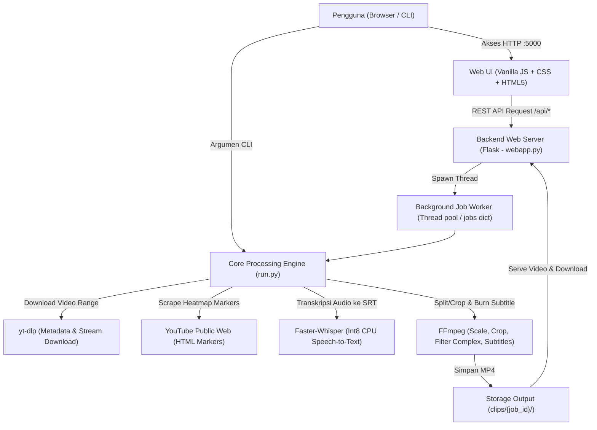
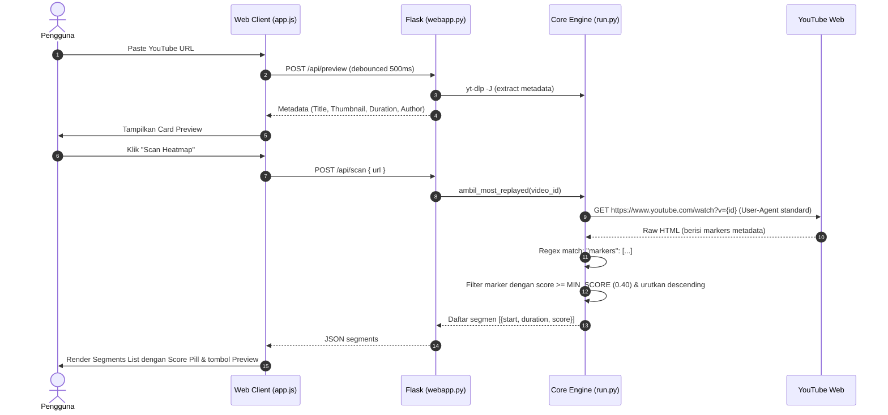
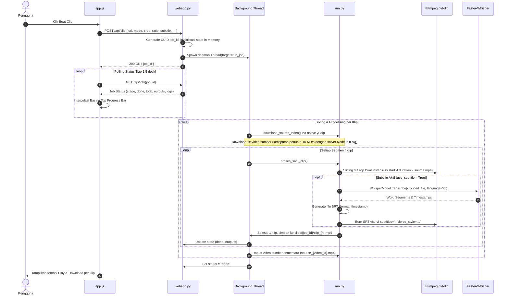

# Analisis Arsitektur Proyek: YouTube Heatmap Clipper 🎬

Dokumen ini membedah secara mendalam seluruh arsitektur teknis, alur data (flow), struktur komponen, antarmuka pengguna (UI/UX), serta logika inti pemrosesan video pada proyek **YouTube Heatmap Clipper (`clipper-ai`)**.

---

## 1. Ikhtisar & Arsitektur Tingkat Tinggi (High-Level Architecture)

YouTube Heatmap Clipper adalah sistem pengolahan video otomatis yang dirancang untuk mendeteksi momen paling menarik (*Most Replayed / Heatmap*) dari video YouTube berdurasi panjang, lalu memotong dan mengonversinya menjadi klip video pendek vertikal (format 9:16 untuk YouTube Shorts, Instagram Reels, dan TikTok) lengkap dengan subtitle AI (*speech-to-text*).

Sistem ini memiliki 2 mode penggunaan:
1. **CLI Mode (`run.py`)**: Mode baris perintah standalone interaktif atau berbasis argumen flags.
2. **Web GUI Mode (`webapp.py` + Single-Page Frontend)**: Antarmuka web interaktif berbasis Flask yang menyediakan visualisasi heatmap, live YouTube preview, seleksi segmen, dan pemantau proses pemotongan klip secara asinkron (*background job thread*).



---

## 2. Struktur Direktori & Peran Komponen

| File / Direktori | Peran Utama | Deskripsi Teknis |
| :--- | :--- | :--- |
| [`run.py`](file:///C:/laragon/www/clipper-ai/run.py) | **Core Processing Engine** | Menangani scraping data Most Replayed dari YouTube HTML, kalkulasi segmen, orkestrasi pemotongan stream via `yt-dlp` & `ffmpeg`, serta integrasi `faster-whisper`. |
| [`webapp.py`](file:///C:/laragon/www/clipper-ai/webapp.py) | **Web Server & Job Queue** | Server Flask yang mengekspos endpoint REST API, manajemen thread latar belakang (`threading.Thread`), in-memory job state tracking, dan cache preview video. |
| [`templates/index.html`](file:///C:/laragon/www/clipper-ai/templates/index.html) | **UI Template** | Markup semantik untuk layout kartu kontrol, pemilih mode/rasio/crop, daftar segmen heatmap, progress bar, dan modal preview player. |
| [`static/app.js`](file:///C:/laragon/www/clipper-ai/static/app.js) | **Frontend State & Controller** | Logika DOM murni (tanpa framework eksternal), sistem i18n dinamis (ID/EN), debounce preview URL, polling job status, dan perhitungan progress stage. |
| [`static/style.css`](file:///C:/laragon/www/clipper-ai/static/style.css) | **UI Design System** | Styling berbasis CSS Custom Properties (Dark Theme / Glassmorphism), responsif mobile/desktop, keyframe animasi, dan indikator progres. |
| [`fonts/`](file:///C:/laragon/www/clipper-ai/fonts) | **Typography Assets** | Berisi font keluarga Google Fonts: *Poppins*, *Plus Jakarta Sans*, *Montserrat*, dan *Roboto* untuk di-burn ke subtitle video via libass FFmpeg serta disajikan via Web UI. |
| [`clips/`](file:///C:/laragon/www/clipper-ai/clips) | **Output Storage** | Direktori penyimpanan berkas hasil render klip video per job ID (`clips/<job_id>/clip_<n>.mp4`). |
| [`start.bat`](file:///C:/laragon/www/clipper-ai/start.bat) | **Windows Launcher & Bootstrapper** | Script batch untuk inisialisasi virtual environment Python (`venv`), instalasi dependensi, auto-detect WinGet FFmpeg, dan menjalankan server web. |
| [`requirements.txt`](file:///C:/laragon/www/clipper-ai/requirements.txt) | **Dependencies Manifest** | Mendaftarkan paket minimal yang dibutuhkan (`requests`, `yt-dlp`, `Flask`). |

---

## 3. Alur Kerja Logika & Pemrosesan Data (Execution Flow)

### 3.1. Alur Deteksi Heatmap (Scraping tanpa API Key)
YouTube menyisipkan data marker intensitas pemutaran ulang (*Most Replayed*) langsung ke dalam payload awal halaman video.



### 3.2. Alur Pembuatan Klip (Background Job Lifecycle)
Ketika pengguna menekan tombol **"Buat Clip"** atau **"Create Selected Clip"**:



---

## 4. Analisis Mendalam Logika Teknis (Deep-Dive Core Logic)

### 4.1. Ekstraksi Marker Most Replayed (`run.py` & `webapp.py`)
Fungsi [`ambil_most_replayed(video_id)`](file:///C:/laragon/www/clipper-ai/run.py#L240-L291):
1. Mengambil HTML mentah dari `https://www.youtube.com/watch?v={video_id}` menggunakan `requests`.
2. Mencari pola JSON marker dengan ekspresi reguler:
   ```python
   r'"markers":\s*(\[.*?\])\s*,\s*"?markersMetadata"?'
   ```
3. Mengurai `heatMarkerRenderer`:
   - `startMillis`: Waktu awal segmen dalam milidetik.
   - `durationMillis`: Durasi segmen yang dicatat heatmap (dibatasi `MAX_DURATION = 60` detik).
   - `intensityScoreNormalized`: Skor normalisasi keterlibatan penonton (0.0 sampai 1.0).
4. Hanya segmen dengan skor $\ge 0.40$ (`MIN_SCORE`) yang dipertahankan, lalu diurutkan dari skor tertinggi ke terendah.

### 4.2. Logika Pemotongan & Rasio Video (Aspect Ratio & Crop Engine)
Aplikasi mendukung 4 preset rasio: `9:16` (720x1280), `1:1` (720x720), `16:9` (1280x720), dan `original`.

### 4.2. Logika Resolusi Dinamis & Crop Video (FFmpeg Filter Complex)
Sistem mendukung 3 tingkat resolusi output:
- **720p (HD)**: 9:16 (720x1280), 1:1 (720x720), 16:9 (1280x720).
- **1080p (Full HD)**: 9:16 (1080x1920), 1:1 (1080x1080), 16:9 (1920x1080).
- **4K (2160p Ultra HD)**: 9:16 (2160x3840), 1:1 (2160x2160), 16:9 (3840x2160).

Khusus format vertikal (`9:16`), aplikasi menyediakan 3 mode crop cerdas:
1. **Default (Center Crop)**:
   Menggunakan ekspresi filter FFmpeg `build_cover_scale_crop_vf`:
   - Menghitung rasio aspek target `ar_expr = out_w / out_h`.
   - Melakukan scaling cerdas: jika rasio input lebih lebar dari target, tinggi disesuaikan ke `out_h` dan lebarnya diskalakan proporsional.
   - Melakukan cropping tepat di tengah layar: `(iw - out_w) / 2 : (ih - out_h) / 2`.
2. **Split Left & Split Right (Khusus Video Gaming / Reaction)**:
   - Membagi tinggi video vertikal menjadi 2 bagian:
     - **Top Section (`top_h`)**: Mengambil bagian tengah layar (gameplay/konten utama).
     - **Bottom Section (`bottom_h`)**: Mengambil sudut kiri bawah (Split Left) atau sudut kanan bawah (Split Right) dari gameplay di mana kamera wajah (*facecam*) biasanya diletakkan.
   - Menggunakan filter complex FFmpeg:
     ```text
     [scaled]split=2[s1][s2];
     [s1]crop=out_w:top_h:(iw-out_w)/2:(ih-out_h)/2[top];
     [s2]crop=out_w:bottom_h:0:ih-bottom_h[bottom];
     [top][bottom]vstack[out]
     ```
   - Hasil kedua crop digabungkan secara vertikal menggunakan filter `vstack`.

### 4.3. Pipeline Subtitle AI Otomatis (Faster-Whisper & libass)
Fungsi [`generate_subtitle()`](file:///C:/laragon/www/clipper-ai/run.py#L323-L382):
1. **Model Loading & Quantization**:
   - Memanfaatkan library `faster-whisper` (implementasi CTranslate2) yang berjalan dengan kuantisasi `int8` pada CPU:
     ```python
     WhisperModel(WHISPER_MODEL, device="cpu", compute_type="int8")
     ```
   - Memberikan kecepatan transkripsi 4-5x lebih cepat dibanding OpenAI Whisper standar dengan penggunaan RAM rendah.
   - Mendukung penanganan khusus pada Windows (fallback symlink cache HuggingFace ketika terjadi `WinError 1314`).
2. **Format Subtitle (SRT)**:
   - Mengonversi hasil transkripsi menjadi penanda waktu SRT standar (`HH:MM:SS,mmm`).
3. **Hardcoded Burning via FFmpeg (libass)**:
   - Subtitle langsung dibakar (*hardsub*) ke dalam frame video menggunakan filter FFmpeg `subtitles`:
     ```bash
     -vf subtitles='temp.srt':fontsdir='fonts':force_style='FontName=Poppins,FontSize=13,Bold=1,PrimaryColour=&HFFFFFF,OutlineColour=&H000000,BorderStyle=1,Outline=2,Shadow=1,Alignment=2,MarginV=35'
     ```
   - **Prinsip Koordinat Virtual libass (`PlayResY=288`)**:
     Ketika membaca berkas `.srt`, libass secara default merender teks di atas kanvas virtual `PlayResY = 288` dan **secara otomatis mengompensasi serta menskalakan** ukuran font ke resolusi video target (baik 720p, 1080p, maupun 4K). Dengan menggunakan nilai `FontSize=13`, tinggi subtitle konsisten di angka 2.7% - 2.8% dari tinggi video dan lebar sekitar 66% tanpa menutupi wajah subjek.
   - **Font Directory Auto-Discovery**:
     Karena libass tidak membaca subdirektori di dalam `fontsdir`, sistem dilengkapi fungsi `ensure_fonts_available()` yang memastikan berkas `.ttf` (Poppins, Plus Jakarta Sans, Montserrat, Roboto) terbaca langsung dari direktori `fonts/`.
   - `Alignment=2` menempatkan teks di tengah bawah (*bottom*), sedangkan `Alignment=5` menempatkan teks di tengah layar (*center*).

---

## 5. Arsitektur Antarmuka (UI/UX Review)

### 5.1. Desain Visual & Pengalaman Pengguna (UX)
1. **Glassmorphism & Tema Gelap**:
   - Palette warna modern: `--bg1: #070915`, aksen ungu `--btn: #6d28d9`, serta efek blur `backdrop-filter: blur(10px)` pada kartu dan navigasi.
   - Tipografi menggunakan font modern **Plus Jakarta Sans** yang dimuat lokal.
2. **Instant Preview dengan Debouncing**:
   - Saat link YouTube ditempel di field input, JavaScript mendeteksi perubahan dengan debounce 500ms dan segera memanggil `/api/preview`.
   - Kotak kartu preview menampilkan thumbnail YouTube beresolusi tinggi, judul video, nama channel/uploader, dan total durasi.
3. **In-App Modal Video Player**:
   - Pemutar YouTube resmi (`iframe embed`) menggunakan domain `youtube-nocookie.com` dengan parameter `?start={s}&end={e}&autoplay=1&mute=1&playsinline=1&rel=0&enablejsapi=1`.
   - Menggunakan header & meta `referrerPolicy="strict-origin-when-cross-origin"` agar tidak diblokir oleh kebijakan keamanan peramban pada lingkungan localhost (`http://127.0.0.1:5000`).
   - Menyediakan tombol fallback langsung **"↗ Buka di YouTube"** di dalam modal untuk video yang membatasi embedding eksternal.
   - Klip yang selesai diproses dapat langsung diputar secara lokal melalui tag HTML5 `<video>` dalam modal popup tanpa harus mengunduh berkas terlebih dahulu.
4. **Top Progress Bar Cerdas**:
   - Aplikasi tidak hanya mengandalkan status angka kasar, melainkan memiliki fungsi simulasi interpolasi waktu (`computeJobPct` dengan kurva easing `easeOutCubic`).
   - Setiap tahapan (`download`, `crop`, `subtitle_transcribe`, `burn_subtitle`) memiliki bobot durasi estimasi sehingga bar kemajuan bergerak mulus dan dinamis.
5. **Dukungan Dua Bahasa (i18n)**:
   - Dukungan penuh Bahasa Indonesia (ID) dan Bahasa Inggris (EN) yang disimpan ke `localStorage`. Pergantian bahasa dilakukan secara reaktif di sisi client tanpa memuat ulang halaman.
6. **Form Judul, Caption, & Hashtag (#) Generator untuk Setiap Klip**:
   - Setiap klip yang berhasil dibuat otomatis dilengkapi kit media sosial lengkap yang siap diunggah ke YouTube Shorts, Instagram Reels, dan TikTok.
   - **Judul (Title)**: Menggabungkan hook viral berbasis kutipan transkrip segmen, kreator, dan nomor part. Dilengkapi tombol variasi judul alternatif.
   - **Caption**: Ringkasan cuplikan konten video, informasi kreator, dan ajakan interaksi (Call To Action).
   - **Hashtags (#)**: Kompilasi hashtag evergreen viral (`#shorts #fyp #viral #trending #reels #youtubeshorts`) + hashtag kontekstual dari judul video, nama channel, dan topik pembicaraan.
   - Dilengkapi tombol 1-klik salin (*Copy Judul, Copy Caption, Copy #, Salin Semua Lengkap*) dengan feedback visual instan.

7. **Fullscreen Loading Overlay & Proteksi Anti-Close / Refresh**:
   - Saat proses pembuatan klip berlangsung, antarmuka mengunci layar penuh dengan backdrop blur (`z-index: 99999`) dan *orbital spinner* berputar ganda.
   - Menampilkan progress bar bertahap (*shimmer animation*), counter klip real-time, dan status 4-tahap pemrosesan: `Download` ➔ `Crop` ➔ `Subtitle` ➔ `Burn Subtitle`.
   - **Proteksi Navigasi Browser**: Mencegah penutupan tab atau reload halaman tidak sengaja dengan mengaitkan `beforeunload` (dialog konfirmasi browser) dan mencegat tombol pintasan keyboard `F5`, `Ctrl+R`, dan `Cmd+R` yang disertai animasi getar (*shake alert*) pada kotak peringatan.
8. **Animasi Pemindaian Radar & Skeleton pada Heatmap Scan**:
   - Tombol *Scan Heatmap* bertransformasi menjadi status *loading* dengan spinner berputar.
   - Panel Segmen menampilkan animasi radar holografik (rotasi sapuan *conic sweep* + *sonar ping pulse*) serta kartu *skeleton shimmer* yang bergerak lembut saat sistem menghubungi YouTube dan mengekstrak kurva *Most Replayed*.
9. **Alur 1-Klik Langsung Upload ke TikTok Creator Studio**:
   - Dilengkapi opsi checkbox *“🎵 Otomatis arahkan ke TikTok Upload setelah klip selesai”* serta tombol individual *“🎵 Upload ke TikTok”* pada setiap kartu klip hasil pembuatan.
   - **Alur Otomatis**: Seketika klip selesai dirender, berkas video `.mp4` otomatis diunduh ke folder *Downloads*, teks caption dan hashtag viral disalin ke clipboard, dan tab baru langsung terbuka menuju [TikTok Creator Studio Upload](https://www.tiktok.com/creator-center/upload). Pengguna cukup menyeret video dan menekan `Ctrl+V` pada kolom deskripsi.

---

## 6. Ringkasan Endpoint API Backend (`webapp.py`)

| Method | Endpoint | Payload Request | Response | Fungsi |
| :--- | :--- | :--- | :--- | :--- |
| `GET` | `/` | - | HTML | Render halaman utama `index.html`. |
| `POST` | `/api/preview` | `{"url": string}` | `{"ok": true, "preview": {...}}` | Mengambil metadata video via `yt-dlp -J` dengan in-memory cache (max 200 entri). |
| `POST` | `/api/scan` | `{"url": string}` | `{"ok": true, "segments": [...], "duration": int}` | Mengambil daftar segmen Most Replayed heatmap. |
| `POST` | `/api/clip` | `{url, mode, crop, ratio, subtitle, whisper_model, ...}` | `{"ok": true, "job_id": string}` | Mendaftarkan pekerjaan pemotongan klip baru ke thread latar belakang. |
| `GET` | `/api/job/<job_id>` | - | `{"ok": true, "job": {...}}` | Polling status pekerjaan, persentase tahapan, dan daftar berkas video yang telah selesai. |
| `GET` | `/clips/<job_id>/<file>` | - | Video File (`video/mp4`) | Streaming atau download klip video hasil pemrosesan. |
| `GET` | `/assets/fonts/<file>` | - | Font File (`.ttf`) | Menyajikan berkas font untuk browser. |

---

## 7. Keunggulan Sistem & Rekomendasi Pengembangan

### Keunggulan Desain
- **Tanpa Kuota API YouTube**: Mengakses data heatmap langsung dari marker publik web YouTube tanpa memerlukan Google Cloud Console / API Key.
- **Pipeline Unduhan Berkecepatan Tinggi (Native Multi-Threaded yt-dlp + Node.js JS Runtime)**:
  - Mengatasi throttling n-sig YouTube dengan auto-detect engine JavaScript (`node`).
  - Mengunduh berkas sumber satu kali (`download_source_video`) dengan 4 thread paralel (`-N 4`), lalu pemotongan semua klip dilakukan secara lokal oleh FFmpeg dalam hitungan milidetik tanpa koneksi ulang ke GoogleVideo.
- **Eksekusi Asinkron**: Web GUI tidak mengalami freezing saat render karena pemrosesan berat didelegasikan ke thread latar belakang terpisah.
- **Zero-Dependency Frontend**: UI murni berbasis HTML5, CSS3, dan Vanilla ES6 tanpa node_modules, bundler, atau library JS eksternal.
- **Autoplay & Cross-Origin Resilient Video Preview**: Modal preview dirancang tahan terhadap Muted Autoplay Policy dan Referrer Policy browser modern.

### Catatan & Rekomendasi Peningkatan
1. **Manajemen Job State (Persistence)**:
   Saat ini, variabel `jobs = {}` disimpan di memori RAM Python. Jika server Flask di-restart, status job yang sedang berjalan akan hilang. Disarankan menambahkan SQLite sederhana atau berkas JSON state jika ingin persistensi jangka panjang.
2. **Resource Throttling (Worker Concurrency)**:
   Saat ini setiap request `/api/clip` langsung membuat thread baru. Jika beberapa request masuk bersamaan, eksekusi FFmpeg dan Faster-Whisper dapat membebani CPU secara berlebihan. Disarankan membatasi antrean dengan queue worker (`queue.Queue` atau Celery/RQ).
3. **Pembersihan Berkas Temporer (Auto-Cleanup)**:
   Direktori `clips/` akan terus bertambah seiring banyaknya klip yang dihasilkan. Disarankan menambahkan scheduler atau endpoint untuk menghapus klip yang sudah berumur lebih dari 24 jam.
